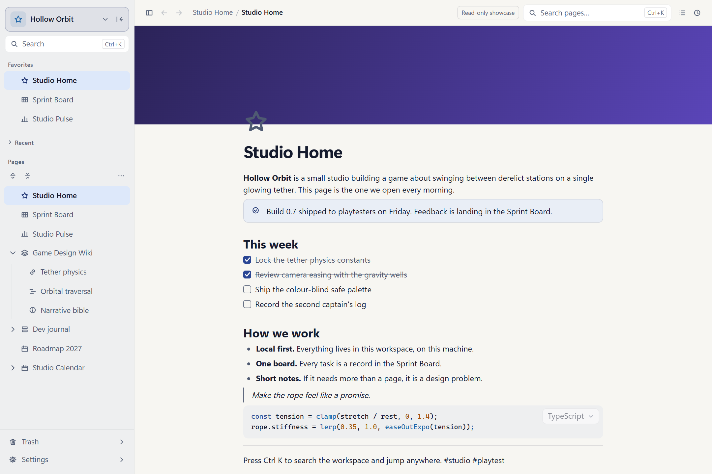
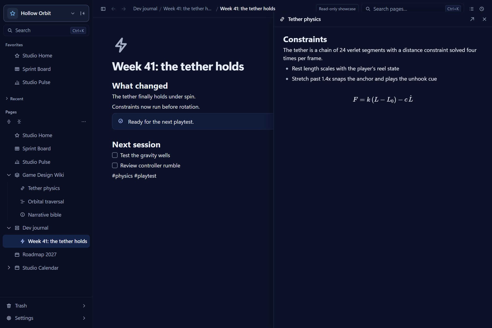
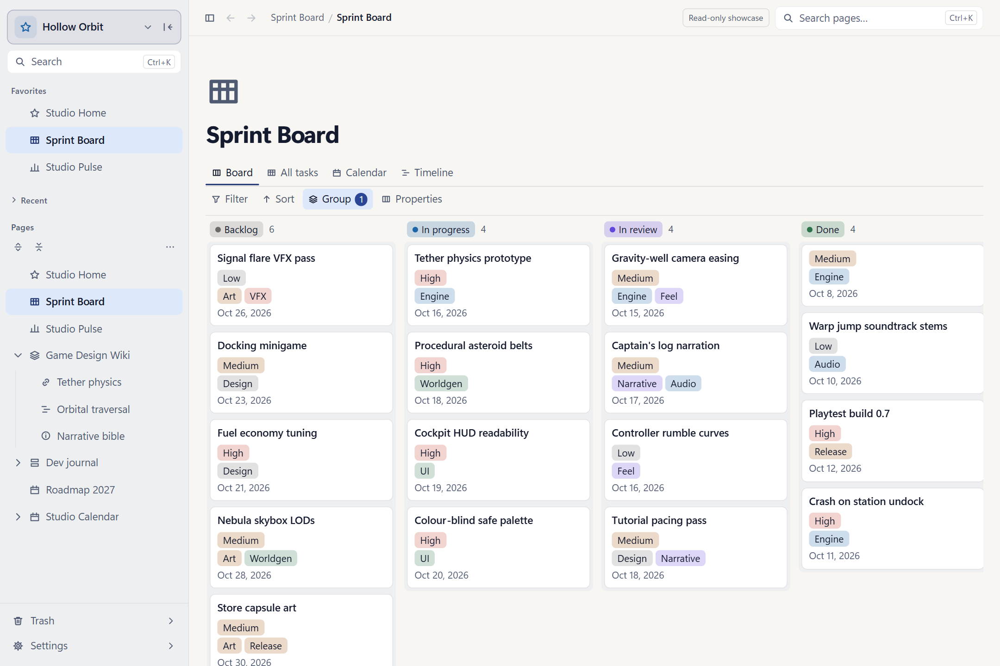
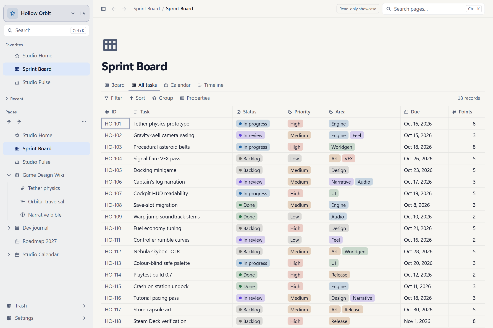
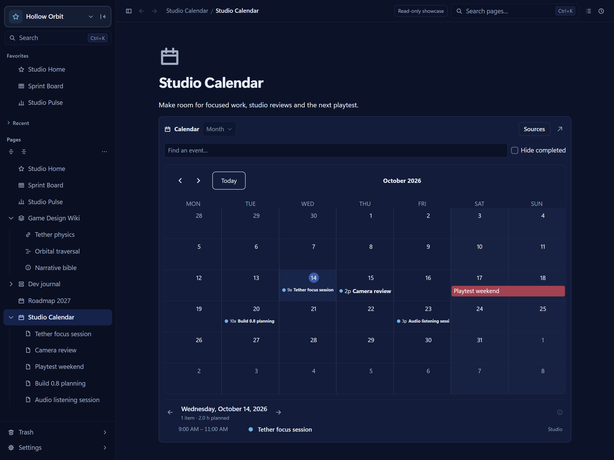
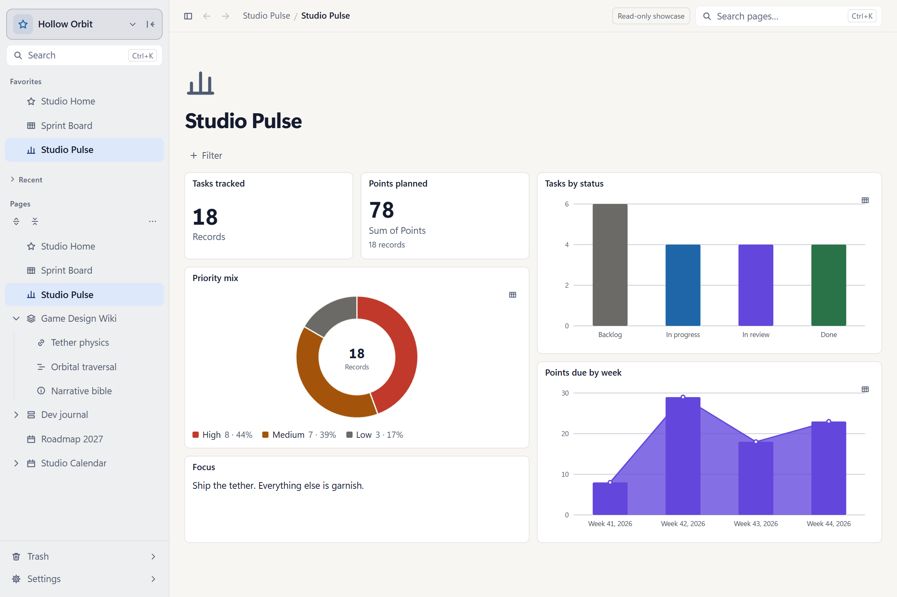

  <picture>
    <source media="(prefers-color-scheme: dark)" srcset="brand/suivelle/png/suivelle-dark-128.png">
    
  </picture>

<h1 align="center">Suivelle</h1>

<strong>Make space for the work that matters.</strong>

A calm desktop workspace for notes, projects, and the plans between them. Write freely. See what comes next. Keep your work close.

LOCAL FIRST &nbsp; · &nbsp; OFFLINE READY &nbsp; · &nbsp; NO ACCOUNT REQUIRED

  <a href="https://github.com/giran03/Suivelle/releases/latest"><strong>Download for Windows</strong></a>
  &nbsp; · &nbsp;
  <a href="https://suivelle.cafetako.com/demo/">Explore the demo</a>
  &nbsp; · &nbsp;
  <a href="https://suivelle.cafetako.com/">Read the wiki</a>
  &nbsp; · &nbsp;
  <a href="docs/changelog/0.1.4.md">What's new in 0.1.4</a>

  <picture>
    <source media="(prefers-color-scheme: dark)" srcset="docs/images/readme-workspace-dark-v014.png">
    
  </picture>

Mock screenshots use Suivelle's interface with fictional Hollow Orbit studio data.

## Give your ideas a home

Capture a thought, write a project brief, or build a personal wiki. Pages support headings, checklists, callouts, quotes, tables, code, equations, images, and attachments. Nest pages, mark favorites, and keep several pages open in tabs.

Bring references into your notes with audio, video, PDFs, and supported web embeds. Pasting a supported media URL lets you choose whether to keep the link or turn it into media; confirmed direct media files are saved as local attachments.

## Keep related work within reach

Connect pages with links and mentions, follow backlinks, and find notes that mention a page without linking to it. Write `#tags` in your notes, browse them across the workspace, or explore connections in the link graph.

Open another page beside the current one to keep a reference close while you write. The outline helps you move between headings and shows word count, character count, and reading time.

## See the same project from every angle

Keep tasks and project details in a database, then choose the view that fits the work: table, board, list, gallery, calendar, timeline, or a freeform canvas of cards, notes, images, and arrows (and workspace canvases for any pages). Each record is a page with room for its own notes.

Use custom properties, filters, sorting, and grouping to bring the right details forward. Track status, dates, priorities, categories, and more without duplicating the underlying records.

Switch to a table when you need the details in one place.

## Make room for your day

Place a calendar inside a page and see events in month, week, day, agenda, or year views. Connect event calendars and database date properties, choose source colors and timezones, and set working hours.

Events are pages with their own rich notes. Plan timed sessions or multi-day events, repeat them daily, weekly, monthly, or yearly, and change one occurrence or a series. Link a work session to a page or block, and use quick-add date phrases when making an event.

Day details show scheduled items, planned time, occupied time, and overlaps. Import or export supported events as `.ics` files when you need to move a calendar elsewhere.

| Keep your rhythm | Stay close to the work |
| :--- | :--- |
| **Daily notes** | Open a date-titled page in your Journal from the command palette or with Ctrl+Alt+D. |
| **Quick capture** | Catch an idea without leaving your flow, from the command palette or a keyboard shortcut. |
| **Search and saved searches** | Find pages and content from the command palette; save searches you return to often. |
| **Reminders** | Set page and event reminders. Notifications arrive while Suivelle is running, including in the tray. |
| **Tabs and recent pages** | Keep pages open, reopen a closed tab, and return to recent work from the tray menu. |

## Bring progress together

Build dashboards with charts, summaries, and text to see how a project is moving. Collect entries through forms, use templates for repeatable work, and let local automations handle recurring steps.

## Make the workspace feel like yours

Choose light, dark, or system appearance. Adjust colors, typography, page width, interface spacing, and scale. Customize shortcuts and motion preferences, and give each workspace its own name and icon.

Keep separate workspaces for personal notes, creative projects, and daily tasks, each with its own pages and organization.

## Keep your work close

Your workspace lives on your computer. Editing works offline with no account required; remote embeds and update checks need an internet connection.

- **History and backups:** revisit page history, keep automatic local backups, and optionally save a second copy to another folder or drive.
- **Portable work:** import existing notes, including supported Notion exports, and export pages or entire workspaces. Workspace archives preserve calendars and internal links.
- **Storage health:** inspect storage, check database integrity, rebuild search, compact the database, and clean up unused files.
- **Recovery:** a safety copy is saved before database upgrades. If an integrity check or upgrade fails, Suivelle can open the workspace read-only so you can export or restore it.

Keep independent backups of important data. Local storage still depends on the security and health of your computer.

## Personal project

Suivelle is a personal app built for everyday use and shared with others. Development, updates, and support happen as time allows.

The app is provided "as is," without warranties, under the MIT License.

For ordinary bugs or feature requests, use the [issue tracker](https://github.com/giran03/Suivelle/issues). For suspected vulnerabilities, follow the [security policy](SECURITY.md).

## License

Suivelle is licensed under the [MIT License](LICENSE). Third-party dependencies and assets remain subject to their respective licenses.

---

<strong>Your ideas. Your rhythm. Your workspace.</strong> Suivelle

