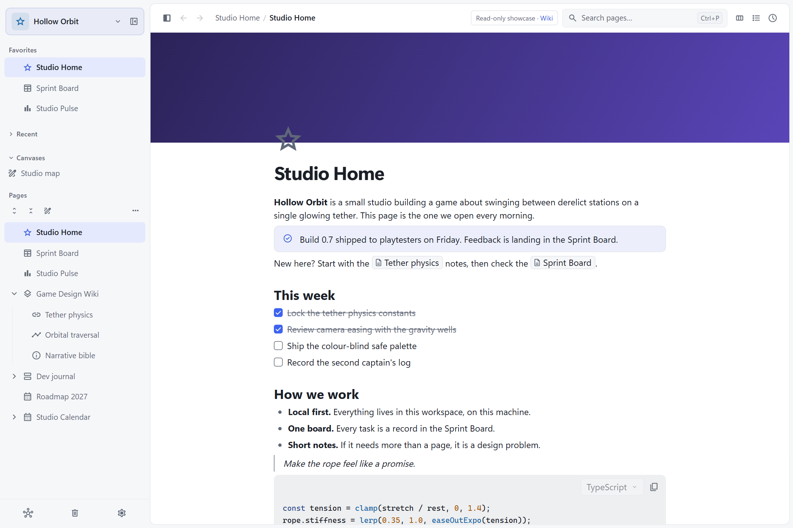
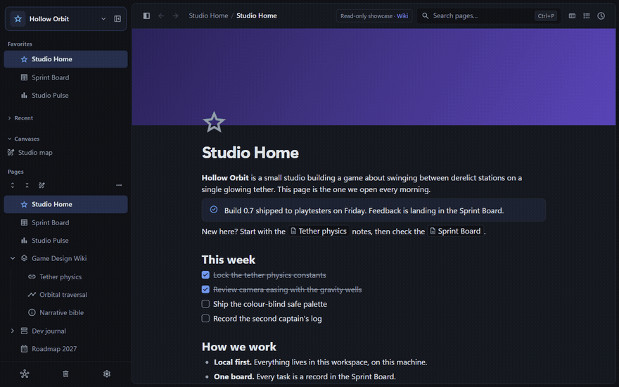
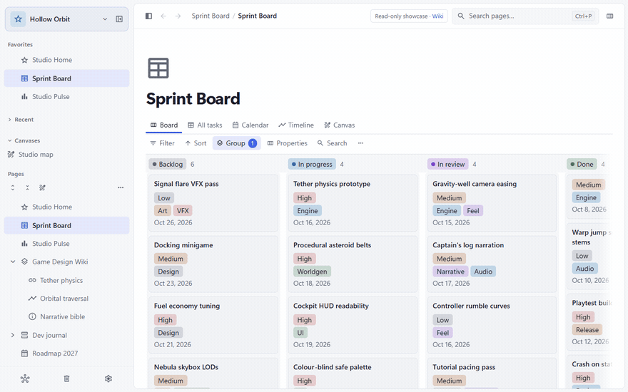
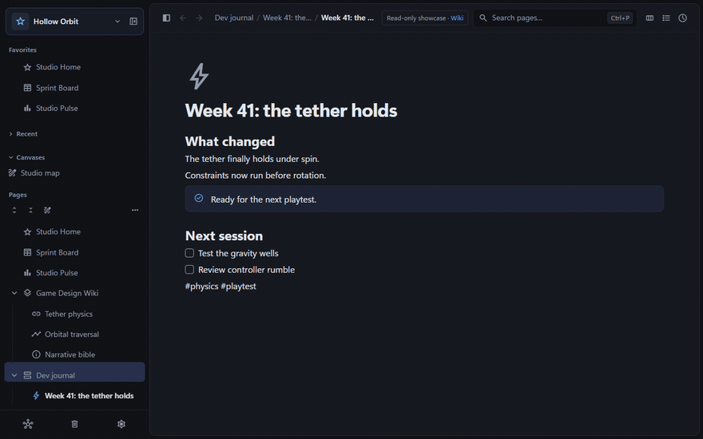
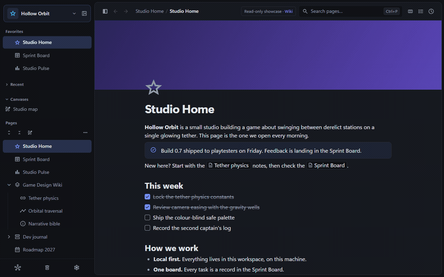
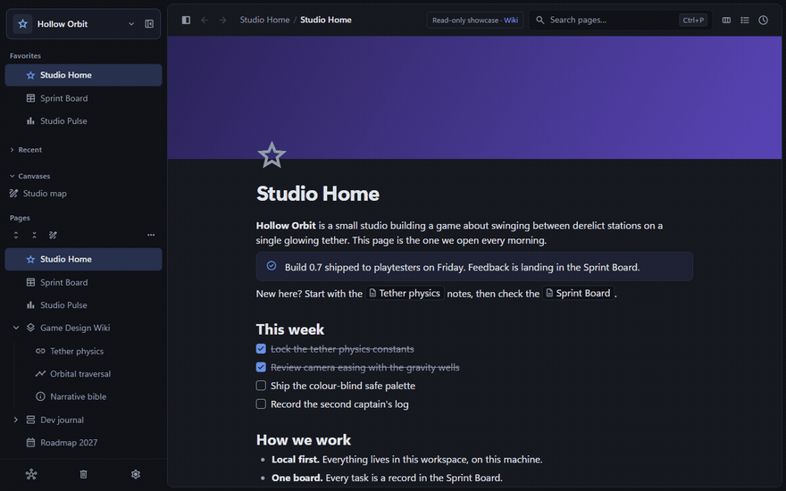

<div align="center">

<picture>
  <source media="(prefers-color-scheme: dark)" srcset="brand/suivelle/png/suivelle-dark-128.png">
  
</picture>

# Suivelle

**Make space for the work that matters.**<br />
A calm, local-first desktop workspace for notes, projects, and the plans between them.

<br />

[](#install)
[](#build-from-source)
[](#your-data)
[](LICENSE)

<br />

[**Download**](https://github.com/giran03/Suivelle/releases/latest) &nbsp;·&nbsp; [**Live Demo**](https://suivelle.cafetako.com/demo/) &nbsp;·&nbsp; [**User Guide**](https://suivelle.cafetako.com/) &nbsp;·&nbsp; [**Shortcuts**](#%EF%B8%8F-keyboard-shortcuts) &nbsp;·&nbsp; [**Changelog**](docs/changelog/)

<br />

<picture>
  <source media="(prefers-color-scheme: dark)" srcset="docs/images/workspace-dark.png">
  
</picture>

<sub>Screenshots and clips show Suivelle's real interface with a fictional game studio, Hollow Orbit.</sub>

</div>

<br />

## ✨ Why Suivelle?

| | |
| :--- | :--- |
| 📝 **Calm block editor** | Write with headings, checklists, callouts, tables, code, KaTeX equations, and media embeds — `/` opens every block. |
| 🗂️ **Connected databases** | Spreadsheet-style editing, Excel-style formulas, rollups, Pivot tables, and 11 views over the same records. |
| 🕸️ **3D & 2D Node Map** | Link pages with `@` or `[[wikilinks]]`, see backlinks, and explore every workspace on an interactive map. |
| 🔒 **Local-first & yours** | Stored in SQLite and a local attachments folder on your computer. Offline-ready, no account required, with verified backups. |

<br />

## 🚀 Feature Highlights

### ⌨️ Fuzzy Command Palette & Quick Navigation
Press `Ctrl+P` to search pages, records, and commands fuzzily — what you use most rises to the top. Open today's note with `Ctrl+Alt+D`, hover any `@` or `[[wikilink]]` to preview it, and trace every backlink.

<p align="center">
  
</p>

### 🗂️ Spreadsheet-Style Databases, Formulas & 11 Views
View the same records as a **Board**, **Table**, **Calendar**, **Timeline**, **Pivot**, **List**, **Gallery**, **Feed**, **Chart**, **Form**, or freeform **Canvas**. Select cell ranges with `Shift+Arrows`, copy/paste TSV, fill down/right (`Ctrl+D` / `Ctrl+R`), filter with `Ctrl+F` view search, add column totals, conditional formatting, and Excel-style formulas.

<p align="center">
  
</p>

### 🪟 Split Panes, Tabs & Side-by-Side Work
Dock pages, tabs, or pane headers onto any edge to build side-by-side or tiled layouts. Each pane sits in a raised card with a focused outline, tabs highlight the active page, and middle-button drag scrolls pages and boards smoothly.

<p align="center">
  
</p>

### 🕸️ 3D & 2D Node Map
Explore every page, database, and connection across all your workspaces in 3D or 2D. Search in place, dive into neighbourhoods, switch layouts, and link or nest pages directly on the map.

<p align="center">
  
</p>

### 🎨 17 Curated Themes, Material Icons & Custom Chrome
Choose from 17 grouped themes — led by **Octopolis Midnight** (dark) and **Paper** (light) — plus custom accent colours, Material Symbols (Outlined, Rounded, or Sharp with adjustable weight and fill), Windows or macOS-style titlebar controls, and a native Win32 tray menu.

<p align="center">
  
</p>

<br />

## 🧩 Everything Else Built In

| | |
| :--- | :--- |
| 📅 **Calendar & Time Blocking** | Put a calendar on any page, create repeating events, bring dates together in a **Master Calendar**, and drag unscheduled tasks onto time slots. |
| 🎨 **Freeform Canvases** | Workspace canvases and database Canvas views with live embedded pages, notes, images, minimap navigation, and labelled connectors. |
| 🤖 **Local AI Agents (Optional)** | Share a local MCP knowledge base with Claude Code, Codex, Cursor, or VS Code. Proposals wait in a review inbox, token usage is tracked, and every change is revertible. Off until enabled in **Settings › Agents**. |
| 🚀 **10 Starter Templates** | Reading List, Contacts & Deals, Content Calendar, Expense Tracker, Job Search, Inventory, Recipe Book, Meeting Notes, Habit Tracker, and Goals & OKRs — each with overview pages and live views. |
| 💾 **Data Safety & Exports** | Page history, automatic daily backups, an optional second-drive mirror, CSV/Markdown/HTML/PDF exports, and Notion or folder imports. |

<br />

## ⌨️ Keyboard Shortcuts

<details open>
<summary><b>Navigation & panes</b></summary>

| Action | Keys |
| :--- | :--- |
| Command palette (fuzzy search) | `Ctrl+P` |
| Today's daily note | `Ctrl+Alt+D` |
| Toggle sidebar | `Ctrl+B` |
| Search inside current database view | `Ctrl+F` |

</details>

<details open>
<summary><b>Writing & linking</b></summary>

| Action | Keys |
| :--- | :--- |
| Insert any block | `/` |
| Link a page or mention | `[[` or `@` |
| Undo / redo | `Ctrl+Z` / `Ctrl+Y` |

</details>

<details>
<summary><b>Tables & spreadsheets</b></summary>

| Action | Keys |
| :--- | :--- |
| Select cell range / all loaded cells | `Shift+Arrows` / `Ctrl+A` |
| Copy / paste range (TSV) | `Ctrl+C` / `Ctrl+V` |
| Fill down / fill right | `Ctrl+D` / `Ctrl+R` |
| Clear selected cells | `Delete` |

</details>

All shortcuts are rebindable in **Settings › Shortcuts and input**. See the full [Keyboard shortcuts guide](https://suivelle.cafetako.com/wiki/shortcuts.html).

<br />

## 📦 Install

1. Download the latest `Suivelle_x.y.z_x64-setup.exe` from [**Releases**](https://github.com/giran03/Suivelle/releases/latest).
2. Run the installer. Suivelle installs for your user account and opens on a short *Getting started* checklist.
3. Installed copies check for updates in the background and make a verified backup before every upgrade.

> [!NOTE]
> Suivelle currently ships for **Windows 10 / 11** (x64).

### Build from Source

Prerequisites: [Node.js](https://nodejs.org/) 24, the stable [Rust](https://rustup.rs/) toolchain, and the [Tauri v2 prerequisites](https://tauri.app/start/prerequisites/) for Windows (WebView2 and MSVC build tools).

```powershell
npm ci             # install dependencies
npm run tauri dev  # run the desktop app with hot reload
```

| Command | Does |
| :--- | :--- |
| `npm run tauri dev` | Run the desktop app with hot reload |
| `npm run build` | Type-check and build the frontend |
| `npm test` | Run the frontend tests |
| `npm run lint` | Lint with Biome |
| `cargo test --manifest-path src-tauri/Cargo.toml --lib` | Run the Rust tests |
| `npm run showcase:build` | Build the website, guide, and read-only demo |

<br />

## 📖 Guide & Documentation

The full 15-page user guide lives at **[suivelle.cafetako.com](https://suivelle.cafetako.com/)**.

- [`docs/`](docs/): feature notes ([agents](docs/agents.md), [calendar](docs/calendar.md), [shortcuts](docs/shortcuts.md), [Smart Paste](docs/smart-paste-and-actions.md), [Node Map](docs/node-map.md))
- [`showcase/README.md`](showcase/README.md): the website, guide, read-only demo, and screenshot/GIF scripts
- [`docs/releasing.md`](docs/releasing.md): publishing signed releases

## About & License

Suivelle is a personal project built for everyday use and shared with others.

- Bugs and feature requests: [issue tracker](https://github.com/giran03/Suivelle/issues)
- Suspected vulnerabilities: [security policy](SECURITY.md)
- License: [MIT License](LICENSE)

---

<p align="center"><strong>Your ideas. Your rhythm. Your workspace.</strong><br /><sub>Suivelle</sub></p>
