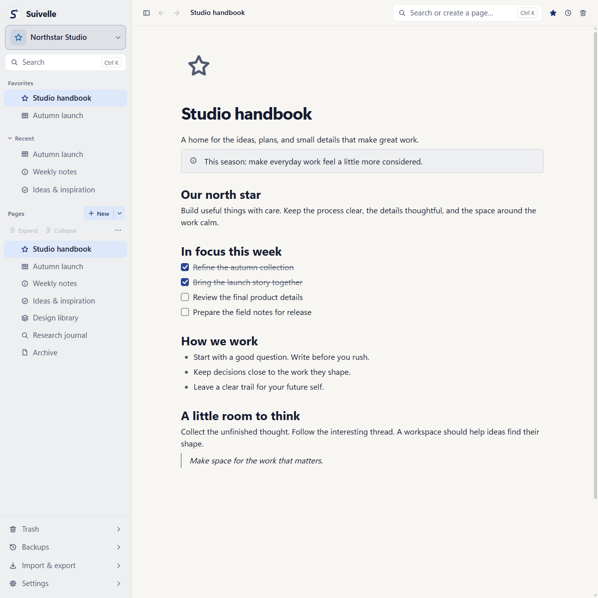
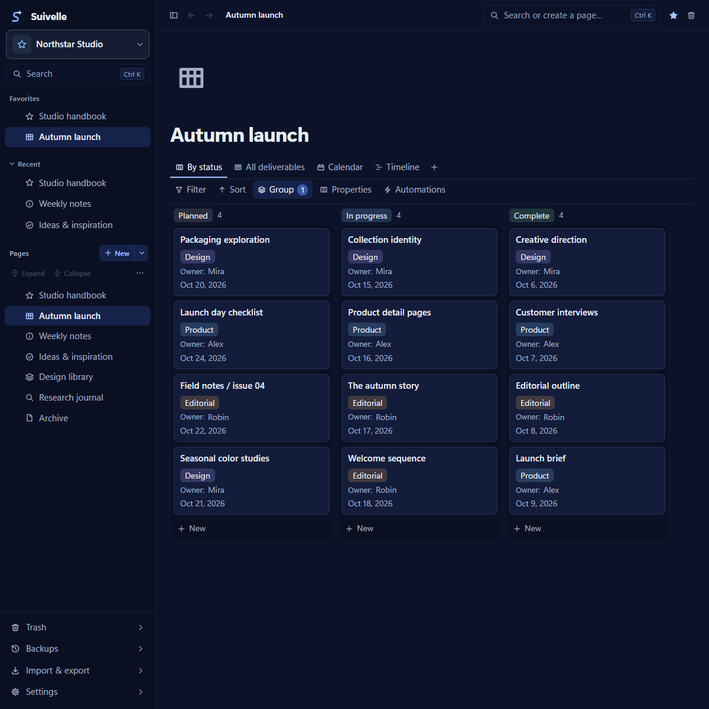
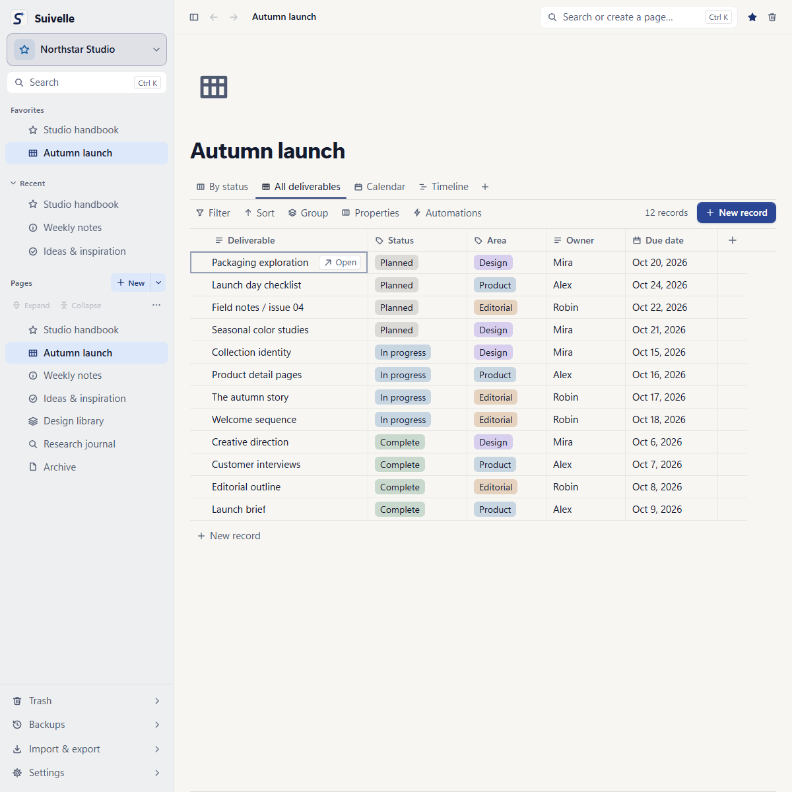

  <picture>
    <source media="(prefers-color-scheme: dark)" srcset="brand/suivelle/png/suivelle-dark-128.png">
    
  </picture>

<h1 align="center">Suivelle</h1>

<strong>Make space for the work that matters.</strong>

A calm desktop workspace for your notes, projects, and ideas. Write freely. Bring plans into focus. Keep your work close.

LOCAL FIRST &nbsp; · &nbsp; OFFLINE READY &nbsp; · &nbsp; MADE FOR FOCUS

  <h2>
      <a href="https://suivelle.cafetako.com/">Explore the demo</a>
  </h2>

https://github.com/user-attachments/assets/e32ecc50-2de8-4d35-b7d2-f530ffe424b2

<strong>Suivelle in motion</strong>

  <picture>
    <source media="(prefers-color-scheme: dark)" srcset="docs/images/workspace-dark.png">
    
  </picture>

## A place for every thought

Capture a quick thought, write a project brief, or build a personal wiki. Shape your pages with headings, checklists, callouts, code, and images. Keep related notes together with nested pages, favorites, links, and mentions.

From the first idea to the finished plan, everything has a place.

## See the whole project

Turn ideas into next steps. Move tasks across a board, compare details in a table, and plan ahead with calendar and timeline views. See the same project from the angle that helps you most.

### Keep the details in view

Track status, dates, categories, and the details that matter to your project. Custom properties, filters, sorting, and grouping help you find what needs attention.

## Built around your day

| Find your flow | Make it yours | Keep it close |
| :--- | :--- | :--- |
| Find notes with quick search, capture ideas as they arrive, and keep several pages open in tabs. | Choose light or dark themes, adjust colors and typography, and give each workspace its own identity. | Work offline, revisit page history, and keep local backups. Import your notes or export them to take your work with you. |

## Make room for every kind of work

Start with a template for a project, task tracker, or software plan. Bring progress together in dashboards and charts, collect entries with forms, and let local automations handle recurring steps.

Keep separate workspaces for personal notes, creative projects, and daily tasks, each with its own pages and organization.

## Your work stays yours

Suivelle keeps your workspace on your computer and works offline, with no account required. Page history and local backups help you return to earlier work. Import existing notes, including Notion exports, and export pages or whole workspaces when you need them elsewhere.

## Personal project

Suivelle is a personal app I built for my own use and share with others.
Development, updates, and support happen as time allows.

The app is provided “as is,” without warranties, under the MIT License.
Use it at your own risk and keep independent backups of important data.

## License

Suivelle is licensed under the [MIT License](LICENSE).
Third-party dependencies and assets remain subject to their respective licenses.

---

<strong>Your ideas. Your rhythm. Your workspace.</strong> Suivelle

